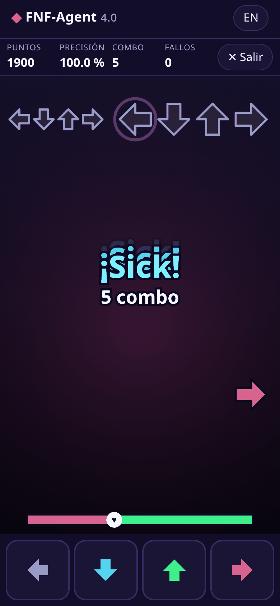
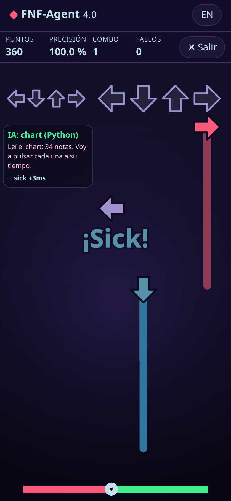
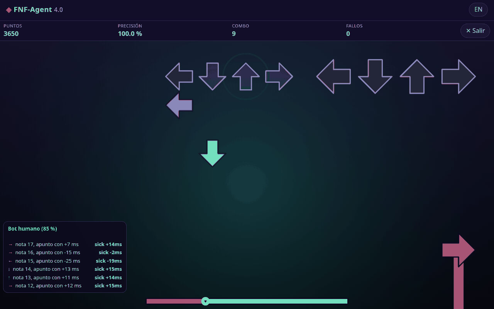

# FNF-Agent

Juego de ritmo en el navegador, al estilo de Friday Night Funkin': juegas tú, un bot o una IA externa por WebSocket.

Funciona en el teléfono (flechas táctiles) y en la computadora (teclado). No hay que instalar nada para jugar. Después de la primera visita también funciona sin internet.

> Idea original de **@NickPro5677**: agentes de IA que aprenden y compiten al ritmo.
> La versión 4 rehace todo en el navegador; el motor viejo en Python sigue en [`legacy/`](legacy/).

[](https://github.com/NickPro5677/fnf-agent/actions/workflows/ci.yml)
[](LICENSE)

[English version](README.en.md)

**Demo:** https://nickpro5677.github.io/fnf-agent/

<p> </p>



## Para qué sirve

Es un entorno compartido: una persona, un bot o un agente externo tocan las mismas flechas al mismo tempo. Sirve para jugar y también para probar agentes.

## Qué trae

- **3 canciones originales** (libres, CC0), cada una en fácil, normal y difícil.
- **Quién juega:** tú, un **bot con 7 perfiles** (Perfecto, Pro, Bueno, Novato, Nervioso, Cansado o Personalizado, con semilla), o **tu propia IA** conectada por WebSocket.
- **Tú vs Bot:** histograma de tus errores de tiempo y comparación con el bot, con tus mejores partidas guardadas.
- Panel en vivo que muestra **qué decide la IA y por qué**.
- Puntos, precisión, combo, barra de vida, calificaciones (Sick, Good, Bad, Miss) y pantalla de resultados.
- Carga **tu propio chart** (JSON de FNF clásico, Psych Engine o v2) y **tu propio audio**.
- Se puede instalar en el teléfono.
- En español e inglés.

## Cómo jugar

### En el teléfono o en la computadora

Abre la [demo](https://nickpro5677.github.io/fnf-agent/). Elige canción y toca **Jugar**.

### En Termux (Android), en local

```sh
pkg install python git
git clone https://github.com/NickPro5677/fnf-agent
cd fnf-agent
python -m http.server 8000 -d web
```

Abre **http://127.0.0.1:8000** en el navegador del teléfono.

## Conectar una IA (en otra sesión de Termux)

Desliza desde la izquierda en Termux → **New session**, y en cada una:

```sh
cd fnf-agent
python agente/relay.py                # sesión 2: el puente en ws://127.0.0.1:8765; muestra un token
python agente/agente_autoajuste.py    # sesión 3: una IA que mide la latencia y toca a tiempo
```

1. Abre el juego **en local** (`http://127.0.0.1:8000`) y elige **IA externa**.
2. En **Ajustes de IA externa** escribe el **token** que mostró el relay (los agentes lo leen solos).
3. Toca **Probar conexión** y luego **Jugar**.

El token es obligatorio y el relay solo acepta el juego servido desde `127.0.0.1` o `localhost`. No compartas el token.

Si el enlace trae `?relay=` o `fnf_token` / `fnf_port` / `fnf_host`, esos valores valen en esa visita. No se guardan en el navegador cuando la página es pública (GitHub Pages). Sí se guardan en `127.0.0.1` / `localhost` (cápsula de escritorio) o cuando el jugador guarda el formulario a mano.

En Ajustes también eliges protocolo (v2/v1), lookahead, Hz y compensación, y puedes guardar perfiles de conexión (se exportan sin el token).

> La demo web (https) **no puede** conectarse a una IA: el navegador bloquea que una página https hable con `ws://127.0.0.1`.
> Para la IA, usa siempre el juego servido en tu teléfono o PC.

Otras IAs de ejemplo:

| Archivo | Qué hace |
|---|---|
| `agente/agente_autoajuste.py` | v2: mide el ping, manda cada tecla con `at` y se corrige solo. Alcanza ≥95 % Sick con 80 ms de latencia. |
| `agente/agente.mjs` | Lo mismo en JavaScript (Node 22, sin dependencias): `node agente/agente.mjs`. |
| `agente/agente_chart.py` | v1: recibe todas las notas al inicio y las toca en el momento justo. |
| `agente/agente_observe.py` | Solo mira lo que llega cerca y reacciona (como un jugador). |
| `agente/ejemplo_llm.py` | Plantilla para conectar un modelo de lenguaje (`FNF_LLM_URL` y `FNF_LLM_KEY`; la clave nunca va en el repo). Sin eso, usa un modelo falso de prueba. |

Para escribir la tuya: [docs/crear-tu-agente.md](docs/crear-tu-agente.md). Mensajes exactos: [docs/protocolo-v2.md](docs/protocolo-v2.md) (y la [v1](docs/protocolo.md)). Formatos de chart: [docs/charts.md](docs/charts.md).

## Reglas del juego

Ventanas de tiempo (iguales que en la versión 3): **Sick ≤ 45 ms, Good ≤ 90, Bad ≤ 135, Miss > 135** (hasta 180).
Tocar sin nota no castiga. Si la vida llega a 0, pierdes.

## Cápsula de escritorio (PC)

Si quieres un clic (juego local + relay con token ya cableado), hay una app Tauri 2 en [`desktop/`](desktop/):

```sh
cd desktop/src-tauri
cargo tauri dev     # desarrollo (hace falta Rust, Tauri CLI 2 y Python 3)
```

No sustituye Termux ni el flujo del teléfono: ahí sigue valiendo `python -m http.server` + relay a mano. Detalles, build y prueba rápida: [desktop/README.md](desktop/README.md).

## Estructura de archivos

```text
fnf-agent/
├── web/          # El juego (módulos ES, sin compilar): motor, canciones, vistas, service worker
├── agente/       # Relay y agentes en Python (solo librería estándar) y un agente en JavaScript
├── desktop/      # Cápsula Tauri 2 (juego local + relay)
├── mcp/          # Servidor MCP para que un asistente juegue
├── tests/        # Pruebas JS, Python y e2e
├── tools/        # Generar canciones y banco de pruebas de agentes (tools/bench/)
├── docs/         # Protocolo, charts, guía para crear un agente, capturas
└── legacy/       # Motor Python de la versión 3
```

## Tecnologías

- JavaScript (módulos ES) en el navegador
- Python 3 (librería estándar) para el relay y los agentes
- Node.js 22 o más, para pruebas y el agente `agente.mjs`
- Tauri 2 y Rust, solo para la cápsula de escritorio
- GitHub Pages

## Para programadores

```sh
npm ci
npx playwright install chromium   # solo para las pruebas e2e (en PC)
./check.sh --quick                # JS + Python + legacy
./check.sh                        # todo, con e2e en Chromium
```

`npm test` corre `./check.sh --quick`. `npm run test:all` incluye las pruebas e2e.

Banco de pruebas de agentes (bots e IAs, métricas y trazas, sin interfaz): [tools/bench/README.md](tools/bench/README.md).

```sh
node tools/bench/cli.mjs sim --perfil perfecto --cancion luz-de-neon --dificultad hard --runs 1
node tools/bench/cli.mjs protocol --agent autoajuste --retraso 80 --runs 3 --min-sick 0.95
```

Cambios y cómo pasar de la v3: [CHANGELOG.md](CHANGELOG.md).

## Estado

Activo. La *release* publicada es la [v4.1.0](https://github.com/NickPro5677/fnf-agent/releases/tag/v4.1.0). En `main` ya están, además, la cápsula Tauri 2, el banco de pruebas de agentes y el arreglo de no guardar el token ni el relay cuando la página es pública. Esos cambios aparecen en el CHANGELOG como «Unreleased»: aún no hay una *release* posterior a 4.1.0.

No hay issues abiertos. Hay una alerta media de Dependabot en `glib` (stack GTK de Tauri 2); de momento no se puede subir de versión con un cambio sencillo.

## Licencia

MIT. Las canciones de demo son originales y CC0. Este proyecto no incluye material de Friday Night Funkin'.
