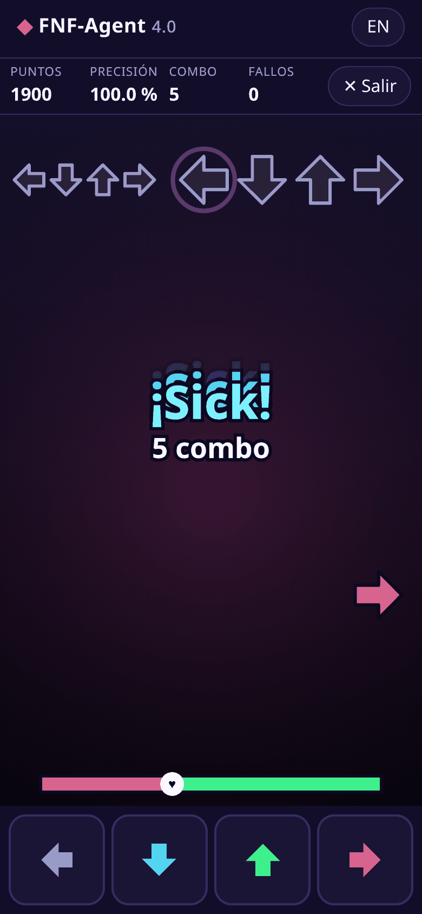
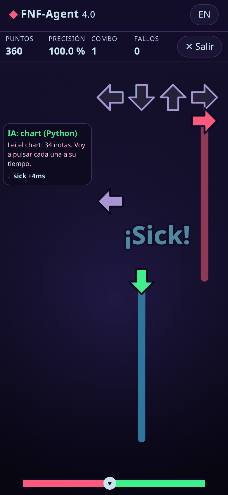
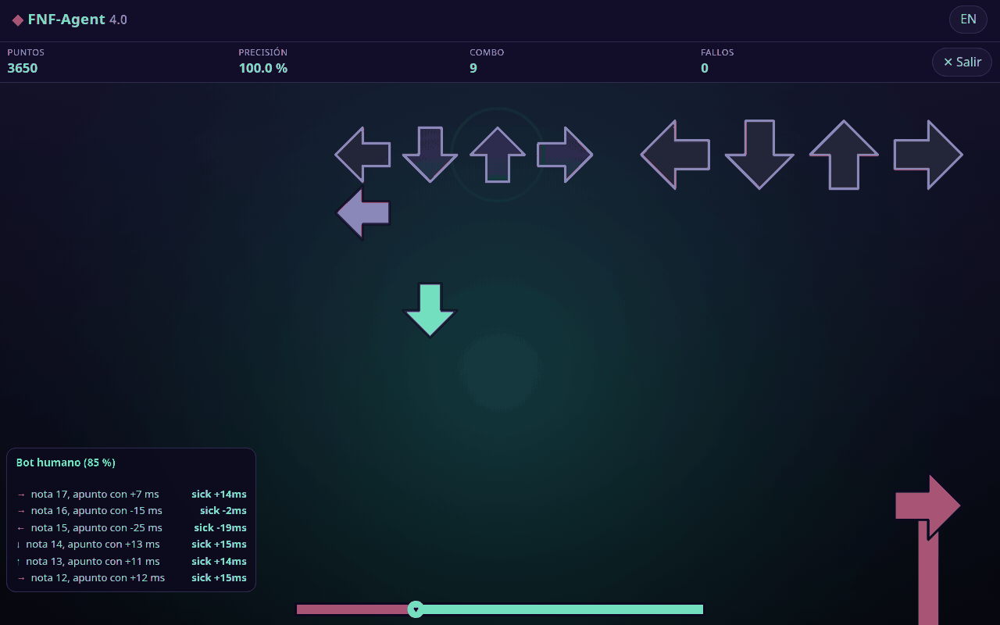

# FNF-Agent 4.0

Un juego de ritmo para el navegador, al estilo de Friday Night Funkin', **hecho para que una IA pueda jugarlo**.
Funciona en el teléfono (flechas táctiles) y en la PC (teclado). No necesita instalar nada para jugar.

> Idea original de **@NickPro5677**: un entorno donde agentes de IA aprenden y compiten tocando flechas al ritmo.
> La versión 4 rehace todo en el navegador, pero la idea es la misma. El motor viejo en Python sigue en [`legacy/`](legacy/).

<p> </p>



[English version](README.en.md)

## Qué trae

- **3 canciones originales** (libres, CC0), cada una en fácil, normal y difícil.
- **Quién juega:** tú, un bot perfecto, un bot "humano" que se equivoca, o **tu propia IA** conectada por WebSocket.
- Panel en vivo que muestra **qué decide la IA y por qué**.
- Puntos, precisión, combo, barra de vida, calificaciones (¡Sick!, Good, Bad, Miss) y pantalla de resultados.
- Carga **tu propio chart** (JSON de FNF clásico, Psych Engine o v2) y **tu propio audio**.
- Funciona **sin internet** después de la primera visita, y se puede "instalar" en el teléfono.
- En español e inglés.

## Jugar en Termux (Android)

```sh
pkg install python git
git clone https://github.com/NickPro5677/fnf-agent
cd fnf-agent
python -m http.server 8000 -d web
```

Abre **http://127.0.0.1:8000** en el navegador del teléfono. Elige canción y toca **▶ Jugar**.

## Conectar una IA (en otra sesión de Termux)

Desliza desde la izquierda en Termux → **New session**, y en cada una:

```sh
cd fnf-agent
python agente/relay.py           # sesión 2: el "puente" en ws://127.0.0.1:8765
python agente/agente_chart.py    # sesión 3: una IA que lee el chart y toca a tiempo
```

En el juego elige **IA externa** y toca **Jugar**. Verás sus decisiones en el panel.

Otras IAs de ejemplo:

| Archivo | Qué hace |
|---|---|
| `agente/agente_chart.py` | Recibe todas las notas al inicio y las toca en el momento justo. |
| `agente/agente_observe.py` | Solo mira lo que llega cerca y reacciona (como un jugador). |
| `agente/ejemplo_llm.py` | Plantilla para conectar un modelo de lenguaje (usa `FNF_LLM_URL` y `FNF_LLM_KEY`). Sin eso, usa un modelo falso de prueba. |

Para escribir la tuya: [docs/crear-tu-agente.md](docs/crear-tu-agente.md). Mensajes exactos: [docs/protocolo.md](docs/protocolo.md).
Formatos de chart: [docs/charts.md](docs/charts.md).

## Reglas del juego

Ventanas de tiempo (iguales que en la versión 3): **Sick ≤ 45 ms, Good ≤ 90, Bad ≤ 135, Miss > 135** (hasta 180).
Tocar sin nota no castiga. Si la vida llega a 0, pierdes.

## Para programadores

```sh
npm ci
npx playwright install chromium   # solo para las pruebas e2e (en PC)
./check.sh --quick                # JS + Python + legacy
./check.sh                        # todo, con e2e en Chromium
```

Estructura: `web/` (juego, sin compilar, módulos ES), `agente/` (relay y agentes en Python, solo librería estándar),
`mcp/` (servidor MCP para que un asistente juegue), `tests/`, `tools/generar_canciones.mjs`, `legacy/` (versión 3).

Cambios y cómo pasar de la v3: [CHANGELOG.md](CHANGELOG.md).

## Licencia

MIT. Las canciones de demo son originales y CC0. Este proyecto no incluye material de Friday Night Funkin'.
